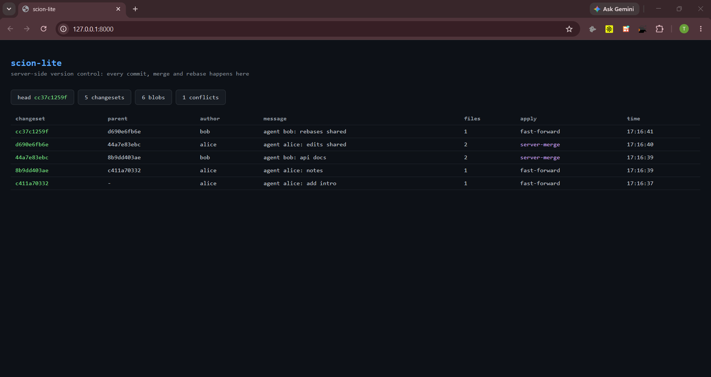

# scion-lite

A miniature server-side version control system: a CLI client plus an HTTP
server that applies every commit, merge and rebase itself. Built as a portfolio
exploration of [Anthropic's "Redesigning source control at Anthropic"](https://www.anthropic.com/research/redesigning-source-control)
(and the [Developers Digest write-up](https://www.developersdigest.tech/blog/anthropic-scion-source-control-git-agents-2026)
of it). Anthropic's answer to agent-scale development was Scion, an
in-house system where *everything happens server-side*. scion-lite is that
idea at teaching scale: about 1,100 lines of dependency-free Python (client,
server, tests and demo), a write-ahead log, and a live dashboard.

[](https://github.com/trytotest13/Scion-Lite/actions/workflows/ci.yml)


## Preview

The live dashboard after two agents (alice and bob) commit against one
server: three fast-forwards, two automatic server-merges and one rejected
conflict.



> Anthropic's bet: coding is no longer the bottleneck, source control built
> for human scale is. Their fix was to stop pretending clients can be
> offline: *assume the client is online, and ask the server.* scion-lite
> implements that bet; the trade-offs are spelled out under Design principles.

## Features

```
 agent alice                agent bob                 server (source of truth)
 ┌──────────────┐          ┌──────────────┐          ┌────────────────────────┐
 │ scion add    │          │ scion add    │          │  blobs   (sha256)      │
 │ scion commit ├───POST──►│ scion commit ├───POST──►│  changesets (snapshots)│
 │ (cache only) │          │ (cache only) │          │  refs/main             │
 └──────────────┘          └──────────────┘          │  wal.jsonl             │
                                                     │  → three-way merge     │
        head moved? no problem: the SERVER merges    │    happens HERE        │
                                                     └────────────────────────┘
```

- **Server-side merges.** The client sends `based_on` + changed files; the
  server three-way-merges onto the current head. Fast-forward when possible,
  automatic merge when the head moved and the files don't overlap, HTTP 409
  with the conflicting paths when they do.
- **Changesets, not packfiles.** Every changeset is a full snapshot
  (`{path: blob_sha}`) stored as one JSON file, content-addressed by the
  SHA-256 of its canonical record.
- **Write-ahead log.** Applies and conflicts are appended to `wal.jsonl`
  before the ref is updated. If the server crashes between the two, the next
  start rebuilds `refs/main` from the last valid apply.
- **Thin client.** The CLI keeps a bounded cache in `.scion/` (config, last
  synced tree, staging area). `scion pull` is an authoritative sync: the
  server wins, and overwritten files are backed up under `.scion/backup/`.
- **Live dashboard.** Open the server root in a browser: head, changeset
  count, blob count, conflicts, and the last 15 changesets (with
  `server-merge` vs `fast-forward` flags), polling every 2 s.
- **Validated boundaries.** Blob and changeset ids are checked before they
  touch the filesystem, so crafted request paths cannot escape the storage
  directory (regression-tested).

## Tech stack

| piece | choice | why |
| --- | --- | --- |
| language | Python 3.9+ | readable, preinstalled on most dev machines |
| dependencies | none (stdlib only) | hashing, HTTP, JSON and diff are all built in |
| server | `http.server` + threading | zero-install demo: `python server.py` and it runs |
| storage | flat files: `objects/`, `changesets/`, `refs/`, `wal.jsonl` | inspectable by hand, no database to set up |
| ids | SHA-256 content addressing | the same guarantee as git objects, one function |

## Quickstart

```bash
# terminal 1: the server (the single source of truth)
python server.py --port 8000 --data ./scion-data
# dashboard: http://127.0.0.1:8000/

# terminal 2: agent alice
mkdir alice && cd alice
python /path/to/scion-lite/scion.py init --server http://127.0.0.1:8000 --author alice
echo "hello" > hello.txt
python ../scion.py add hello.txt
python ../scion.py commit -m "agent alice: first changeset"

# terminal 3: agent bob, same server
mkdir bob && cd bob
python ../scion.py init --server http://127.0.0.1:8000 --author bob
python ../scion.py pull
echo "docs" > api.md
python ../scion.py add api.md
python ../scion.py commit -m "agent bob: docs"   # stale base? server merges it
```

Or watch the whole story in one command:

```bash
python demo.py
```

## Commands

| command | what it does |
| --- | --- |
| `init [--server URL] [--author NAME]` | create a `.scion` workspace; clones the head if one exists |
| `add <file>...` | stage file(s) |
| `rm <file>...` | stage deletion(s) |
| `commit -m "msg"` | upload a changeset; the server merges it onto the head |
| `status` | staged / modified / deleted / untracked vs the synced tree |
| `log [-n N]` | history straight from the server |
| `diff` | working tree vs last synced tree (old blobs fetched from the server) |
| `pull` | authoritative sync to the head (conflicting local files backed up) |
| `whoami` | workspace identity |

## HTTP API

| endpoint | method | purpose |
| --- | --- | --- |
| `/` | GET | live dashboard |
| `/api/state` | GET | head, changeset/blob/conflict counts |
| `/api/log?n=20` | GET | history, newest first |
| `/api/tree?at=<id>` | GET | snapshot: `{path: blob_sha}` |
| `/api/blob/<sha>` | GET | raw blob bytes |
| `/api/changeset` | POST | apply a changeset; server merges, `409` on conflict |

## Design principles (and their trade-offs)

Mirrors of the real Scion design, each a deliberate simplification:

1. **Server-side everything.** Commits, merges, history, blame-equivalents
   are server APIs. *Trade-off:* no local history building, and the server is
   a hard dependency: exactly the HN criticism of Scion, which you can feel
   here by killing the server.
2. **Clients are online.** `commit` *is* `push`. There is no offline queue.
3. **Changesets over packfiles.** Full snapshots, flat blob store, zero repo
   maintenance. *Trade-off:* O(repo) snapshots would not scale like git's
   packfiles (fine at demo scale; the point is the model).
4. **Refs are discouraged.** There is one ref (`main`). Scion says agents
   barely need branches; scion-lite agrees, for now.
5. **File-granularity merge.** Simpler than git's line-level 3-way merge; a
   same-file race is a conflict, not a text merge. *Trade-off:* this is where
   the "merge queue doesn't make sense at agent scale" argument gets tested.

## What's simplified vs. the real Scion

No partial clones, no GC, no signing, no horizontal sharding, no line-level
merges, single process + threading lock (not a distributed coordinator), WAL
without fsync-per-write. All numbers in Anthropic's post (2,500 → 30,000+
merges/day, 25 M checkouts/day, 200× footprint reduction) are reported by
Anthropic and out of scope here: the goal is to make the architecture
testable by hand.

## Testing

```bash
python -m unittest test_scion.py -v
```

Seven integration tests boot a server on an ephemeral port and drive the CLI
through it: commit/log/status/diff/pull round trips, staged deletions,
automatic server-side merges of non-overlapping stale-base commits, a
conflict that comes back as 409 and recovers through pull and re-commit,
WAL head recovery after a simulated crash, and rejection of non-hex ids at
the storage boundary. CI (`.github/workflows/`) runs the same suite on
Python 3.9 to 3.13 plus Windows.

## Roadmap

- line-level (hunk) merge with conflict markers instead of file-level 409s
- branches behind `refs/` for release lines
- `scion blame` / history queries as server APIs
- multiple replicas with leader election (so the server stops being a
  single point of failure)

## License

MIT, see [LICENSE](LICENSE).
